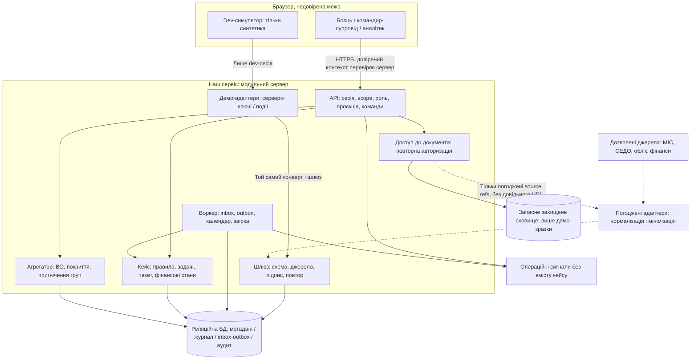

# C4 — контейнери та потоки

**2026-11-13 · проєкт, не реалізація.** Пропонується модульний сервер: менше інфраструктури для демо, одна транзакція для події / стану / задачі / аудиту. Це логічна архітектура за [ADR 0002](adr/0002-service-boundary.md), а не вибір стеку чи production-топології.

| Контейнер / процес | Відповідальність та зберігання | Стан після фази 6 |
|---|---|---|
| Вебклієнт, чотири панелі | Відображення дозволеної проєкції; демо-перемикач не є production-автентифікацією | Запроєктовано; коду немає |
| Сервер API + домен | Серверний доступ, команди, кейс / правила / задачі. Не підписує меддокументи й не призначає виплату | Запроєктовано; перевірки реалізувати / довести у фазах 7–8 |
| Шлюз і адаптери | Перевіряють дозволене джерело / вид події, схему, повтор; адаптер мінімізує клінічні записи до входу в оркестратор | Реальні інтеграції не підтверджені; демонстраційні ще не реалізовані |
| Воркер | Транзакційний inbox / outbox у тій самій БД; обмежені повтори, календар, ручний розбір; без окремого брокера в демо | Логічно окремий процес, може запускатися разом із сервером; ADR 0003 |
| Реляційна БД | Метадані, стани / журнал, області доступу, правила, аудит, агреговані виходи | [Логічна схема](data-model.md); фізичної міграції / вибору СУБД немає |
| Контрольований доступ до документа | Дозвіл перевіряється перед кожним читанням, включно з резервною копією; клієнт не отримує токен джерела | Цільова залежність від прав джерела; у демо тільки вигадані зразки |
| Агрегатор | Фіксовані когорти й визначення BO, мінімальні групи / захист від віднімання, без рядків людей у відповіді | Макет контракту; пороги й OPSEC погодити у фазі 7 |

## Потік із гарантіями

1. Адаптер із належним правом читає джерело, вилучає зайві клінічні поля, формує [наш конверт](event-contract.md). Жодного прямого підключення браузера до реального ЕСОЗ.
2. Шлюз автентифікує джерело й дозволений тип; валідований мінімальний конверт потрапляє в inbox. Відповідь про приймання ще не підтверджує отримання документа ВЛК.
3. Воркер перевіряє особу / випадок / версію, атомарно змінює журнал, поточні проєкції, задачі й аудит та ставить вихідну дію в outbox. Збій транзакції не залишає «успіх» без журналу.
4. Одержувач підтверджує доставку окремою подією. Немає підтвердження — уточнення / повтор за правилом; не автоматична санкція.
5. API на кожний запит перевіряє роль, активне призначення, частину / кейс і дозволені поля. Агрегати мають окрему проєкцію; адміністрування довідників не відкриває медичні документи.

Контур розміщення МОУ, автентифікація Армія+, договори обміну, авторизація з безпеки й резервування реальних даних не виконані цим PR. Цільові адаптери відокремлені, щоб моки замінювалися без зміни доменних правил, але це не доказ сумісності з невідомими API.
