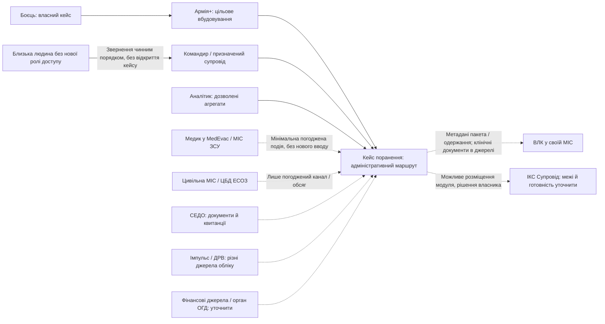

# C4 — контекст системи

**2026-11-13 · логічну архітектуру затверджено, варіант А; реалізації немає.** Нотація C4 передана у Mermaid flowchart. Суцільні зв’язки показують користувацькі взаємодії запропонованого прототипу; пунктир — **цільові інтеграції, не підтверджені API**. Факти / дати — [A01–A10](sources.md), правові межі — [ADR 0001](adr/0001-legal-boundaries.md).

Для навчального застосунку Армія+ не викликається: її роль відтворює власна панель із банером. Медик, ВЛК й фінансові органи працюють у своїх системах; dev-панель імітує дозволені результати, не стає новим робочим місцем лікаря. У production можливість отримання пакета ВЛК залежить від узгодженого доступу / доставки джерел: посилання саме по собі не передає документ.

Командир не є одержувачем клінічного пакета. Мінімальна службова видимість, область частини й чинні канали лишаються обов’язковими навіть за подієвої інтеграції. Розміщення у «Супроводі» не надає додаткових прав. Визначені межі контейнерів — у [C4 container](c4-container.md).
