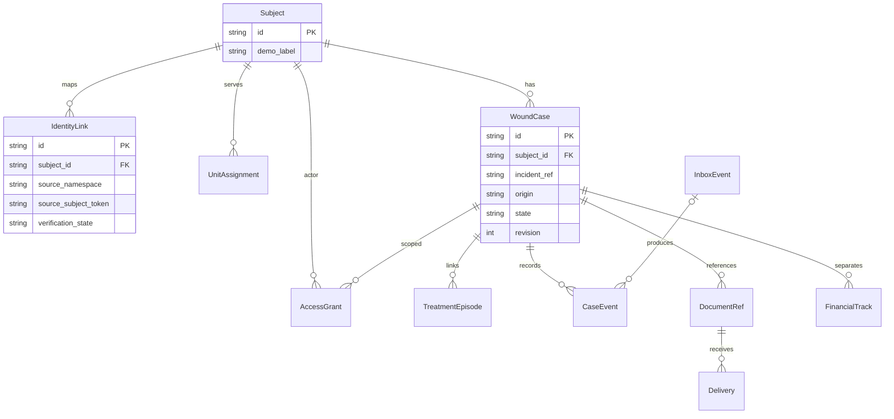
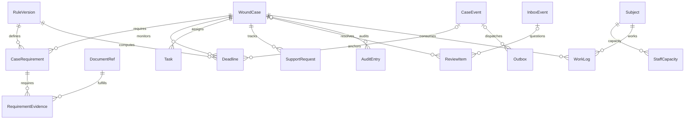

# Логічна модель даних

**2026-11-13 · логічна модель фази 6 затверджена, варіант А. Фізична реалізація запропонована у 8а: [SQL](../../prototype/db/migrations/001-initial.sql), [ADR 0008](adr/0008-demo-stack-and-physical-schema.md).** Реляційні ключі й транзакції описано до вибору СУБД / ORM у фазі 8а. Усі demo-ID нижче — вигадані. Ні opaque ID, ні hash, ні метадані лікування не вважаються автоматично знеособленими. Політики зберігання / шифрування / допуску — перед реальними даними, [ADR 0004](adr/0004-storage-and-document-access.md).

## ERD — ідентичність, кейс і доступ

ERD читається разом із таблицею: actor у AccessGrant — локальний суб’єкт, не всі Subject є користувачами. Призначення частини й грант доступу — різні факти; актуальні часові межі перевіряються на кожний запит. Клінічна постанова не зберігається текстом: її джерельний ref і дозволений службовий стан фіксуються у DocumentRef / CaseEvent.

## ERD — правила й операційна робота

## Сутності, поля й інваріанти

Кожний рядок — логічна таблиця. PK — внутрішній ID; FK — перевірений зв’язок. Обов’язковість іменованих зовнішніх документів задається **за типом пакета й версією правила**, не універсальним списком.

| Сутність | Мінімальні поля | Обмеження й джерело істини |
|---|---|---|
| Subject | id, demo_label, state | Реальна ідентичність у довіреному контурі; demo_label лише для синтетики. Не зберігати тут РНОКПП, пароль чи копію Patient |
| IdentityLink | id, subject_id, source_namespace, source_subject_token, verification_state, proof_ref, valid_from / to | Активний перевірений token у namespace відображається на одну особу; конфлікт не перезаписує mapping. Токен не повертається браузеру. Жодного пошуку за ПІБ / схожістю |
| UnitAssignment | id, subject_id, unit_ref, valid_from / to, source_event_ref, verification_state | Службове призначення з окремим доказом; історичні зміни лишаються. Часові перетини, що конфліктують, ідуть на розбір |
| AccessGrant | id, actor_subject_id, role, case_id або unit_ref, purposes, valid_from / to, revoked_at, authority_ref | Рівно визначений scope; грант не створюється з клієнтського role / unit параметра. Посадове право й область потрібні одночасно; медичний доступ не випливає з доступу до довідників |
| WoundCase | id, subject_id, incident_ref nullable, origin, injury_date nullable, injury_date_assurance, lifecycle_state, revision | Один підтверджений випадок — один кейс. Для невідомого incident_ref не ставити загальний unique на особу: у неї можуть бути різні поранення. За однакового підтвердженого incident у погодженому namespace — unique / явне рішення об’єднання. Адміністративний origin не підтверджує травму |
| TreatmentEpisode | id, case_id, source_system, source_episode_ref, provider_ref, start / end nullable, evidence_ref, assurance | Unique source + episode ref. Зв’язок з кейсом перевірений; перехід між закладами не обнуляє підтверджений початок безперервного лікування. Правило має власний anchor, а не MIN дати надходження мережевих подій |
| InboxEvent | id, source_system, event_id, source_stream, source_version, source_order nullable, event_type, semantic_digest, received_at, minimal_envelope, processing_state | Два унікальні ключі з [контракту](event-contract.md); зберігається лише валідований мінімальний конверт. Сирий клінічний response / відхилений body не зберігаються. Видалення технічного inbox не має дозволити старому повтору знову застосувати дію: потрібен dedupe-tombstone на погоджений горизонт |
| CaseEvent | id, case_id, inbox_event_id nullable, command_id nullable, event_type, occurred_at nullable, recorded_at, source_ref, source_version, assurance, supersedes_id nullable | Незмінний журнал, у т.ч. виправлень; типізовані мінімальні дані замість довільного тексту. Користувацька команда та джерельне підтвердження не ототожнюються |
| RuleVersion | id, rule_key, version, route, applicability, anchor_type, calendar_unit, interval, legal_ref, effective_from / to, approval_state | Unique rule_key + version; лише погоджена застосовна версія. Юридичні й технічні строки різні. Редакція для минулого періоду не підміняється поточною |
| CaseRequirement | id, case_id, route, packet_ref, packet_revision, rule_version_id, document_kind, instance_scope, applicability_state, status | Unique case + route + packet_ref + packet_revision + rule + вид + instance_scope: потрібні виписки різних епізодів не зливаються в одну вимогу. `not_applicable` й `unknown` відрізняються від відсутнього документа. Склад кожної ревізії пакета незмінний; новий склад — новий packet_revision. Для BO-5 перелік когорти фіксується окремим snapshot ref |
| RequirementEvidence | id, case_requirement_id, document_ref_id, evaluation_state, evidence_event_ref | Зв’язок багато-до-багатьох: одна версія документа може виконувати вимоги різних пакетів без копіювання. Unique requirement + document version; збіг case_id обох сторін обов’язковий. Це технічна відповідність, не юридичне рішення |
| DocumentRef | id, case_id, source_system, source_record_ref, document_version, kind, provenance, validation_state, classification, supersedes_id nullable | Unique case + source + record + version: це case-local посилання; той самий джерельний документ може мати окреме посилання в іншому підтвердженому кейсі без копії клінічного body. Належний документ, технічна перевірка й фото-копія мають різні ознаки; жодного статусу «гарантує право». Source ref не довільний URL |
| Delivery | id, document_ref_id, recipient_ref, delivery_kind, sent_at nullable, received_at nullable, receipt_ref, state | Квитанція прив’язана до **версії** й адресата; unique document version + recipient + delivery kind. Відправку не підміняти одержанням. Нове виправлення потребує власного підтвердження |
| Deadline | id, case_id, rule_version_id, anchor_event_id nullable, anchor_date nullable, due_date nullable, applicability_state, anchor_status, provisional_follow_up_date nullable, status, calculation_revision | Немає підтвердженого початку / застосовності — due_date null і задача уточнення. Unique активне правило / застосування. Зберігати календарну дату й окремо пояснення часового поясу; не рахувати місяці як фіксовані секунди |
| Task | id, case_id, kind, owner_role, owner_scope, status, deadline_id nullable, trigger_ref, resolution_code | Unique trigger + kind + owner у межах застосування; повтор події не множить задачі. Закриття має результат / доказ, а не лише натискання бійця |
| FinancialTrack | id, case_id, payment_kind, period_start / end, current_status, reason_code, decision_ref nullable, execution_ref nullable, source_version | Вид reward / ogd і період розділено. Unique case + вид + період; часткові / перекривні періоди узгоджуються, не підсумовуються автоматично. `executed` потребує доказу від джерела саме виконання; суми / банківські реквізити не потрібні MVP |
| SupportRequest | id, case_id, category, owner_scope, state, result_code, authority_checked | Родинне звернення не створює AccessGrant; не копіювати контакти / вільний клінічний текст у публічне демо. Загальний гайд працює без case_id / сесії |
| ReviewItem | id, case_id nullable, inbox_event_id nullable, reason_code, assigned_scope, state, resolution_event_ref | Є хоча б один предмет розбору; рішення уповноваженої особи аудитується. Невідомий subject / incident не стає автоматичним збігом |
| AuditEntry | id, actor_ref, role, action_code, opaque_object_ref, result_code, occurred_at, correlation_ref | Журнал дозволів / відмов / змін; без діагнозів, документних body, токенів або довільного URL. Навіть opaque ref у реальному контурі чутливий. Читання / зміна стану без потрібного запису аудиту не вважається успішною |
| Outbox | id, case_event_id nullable, action_type, destination_ref, idempotency_key, minimal_payload, attempt_count, next_attempt_at, state | Атомарно з доменною зміною; unique destination + idempotency key. Немає автоматичного необмеженого повтору; жодних медичних body |
| StaffCapacity | id, staff_subject_id, reporting_scope, period, fte, source_ref | Погоджений ресурс для BO-6, не кількість облікових записів; невідомий FTE не дорівнює 1. Лише вигадані значення в демо |
| WorkLog | id, case_id, staff_subject_id, work_date, minutes, activity_code, source_ref | Облік фактичної роботи для BO-6, не тривалість відкритого кейсу; записи не копіюються з реальних працівників |

Агрегований звіт — проєкція з `definition_version`, `cohort_snapshot_ref`, `as_of`, покриттям, знаменником і `suppression_state`. Окремого сховища / BI-платформи для демо не потрібно. Аудит і доступ обмежуються окремими технічними правами навіть в одній БД.

## Автомати станів і календар

- Кейс: `administrative_open` → `source_linked` → відповідні маршрутні етапи; невідомі дані позначені окремо. Три паралельні лінії — лікування / ВЛК, винагорода, ОГД. Одна постанова не закриває все.
- Документ: походження `source_reference` / `manual_demo_copy`; підтвердження джерела, чинність версії й доставка — **окремі осі**, не одна зелена галочка. Відкликання не видаляє історію й робить залежну комплектність такою, що потребує перегляду.
- Фінансовий стан: `unknown`, `under_review`, `returned`, `denied`, `approved`, `accrued`, `executed`. Не кожний вид має всі етапи; дозволені переходи / коди задаються погодженим словником джерела. Повернення не є остаточною відмовою, approved не є executed.
- Календар застосовує підтверджений anchor і версію норми: чотири календарні місяці лікування, п’ять днів у визначеному випадку довідки; правила ОГД мають особливість воєнного стану з N07 п.23. Для N16 ст.260 anchor — **отримання первинного облікового медичного документа військовослужбовцем**, а за відсутності — визначеної довідки про перебування в закладі, і тільки за застосовності випадку дій противника. Отримання inbox / частиною / ВЛК або створення еПМК не є цим anchor. Немає належного доказу й дати — due_date null, навіть якщо інші технічні дати відомі.

Уточнення [ADR 0006](adr/0006-primary-trigger-and-certificate-clock.md): `anchor_status=estimated` дозволяє окреме `provisional_follow_up_date` за датою внесення еПМК з позначкою «дату отримання підтвердити»; `due_date` лишається null. `confirmed` потребує належного підтвердження отримання військовослужбовцем і застосовності дій противника. Орієнтир не бере участі в обліку юридичних прострочок і не змінює права.

Конкретний спосіб обчислення меж календарних дат, кінця місяця й виправлення anchor має бути погоджений і перевірений граничними тестами до демо; клієнтський час не джерело юридичного строку. Injury_date для BO-1 теж має власний доказ: час відкриття кейсу чи запису еПМК не стає датою поранення автоматично.

## Звідки рахуються BO

| Метрика | Сутності / виключення |
|---|---|
| BO-1 | Підтверджена injury_date та відповідний CaseEvent постанови; невідомі дати / інший тип постанови виключаються з поясненням. Відкриті кейси показуємо окремо |
| BO-2 | Зафіксована когорта за CaseEvent одержання пакета визначеним адресатом і мотивовані повернення з route / packet_ref / packet_revision; CaseRequirement зберігає склад ревізії. Рахуємо унікальний case + route + packet_ref, не кількість версій; ВЛК / ОГД окремо, горизонт спостереження явний |
| BO-3 | Лише підтверджений код причини зупинки від належного джерела; Deadline не є джерелом такого рішення. Немає підтвердження / покриття — [TBD], не 0 |
| BO-4 | Окрема контекстна картка / зовнішній офіційний агрегат із датою; індивідуальні скарги й causal cohort не отримані. Без вигаданого тренду |
| BO-5 | Усі потрібні документи погодженого snapshot-пакета в знаменнику; Delivery версії / адресата й спосіб доставки — у чисельнику. Невідомий спосіб / неотримані документи не зникають |
| BO-6 | Активні кейси на визначений зріз і погоджений StaffCapacity; окремо WorkLog / кейси, охоплені обліком часу. Визначення періоду / покриття погоджується; не імітувати робочі хвилини віком кейсу |

Числові цілі й baseline не змінені: див. [контракти фази 5](../05-product-concept.md#8-метрики-й-межі-висновку). Всі справжні значення [TBD].
