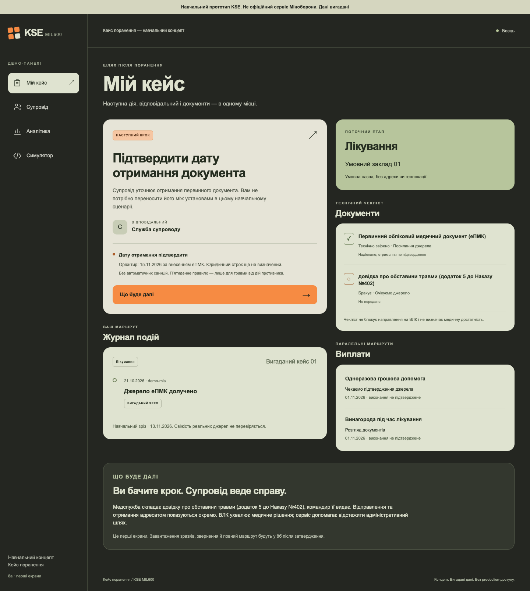
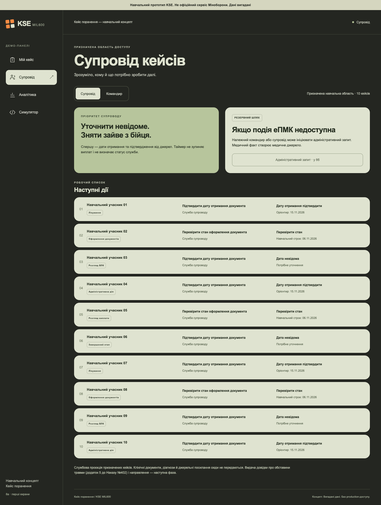
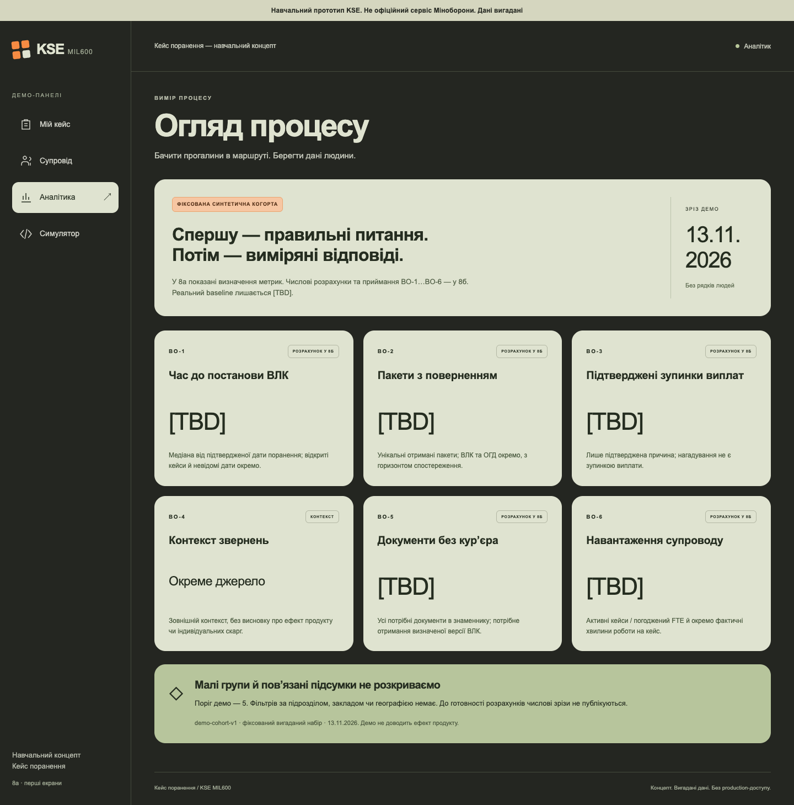
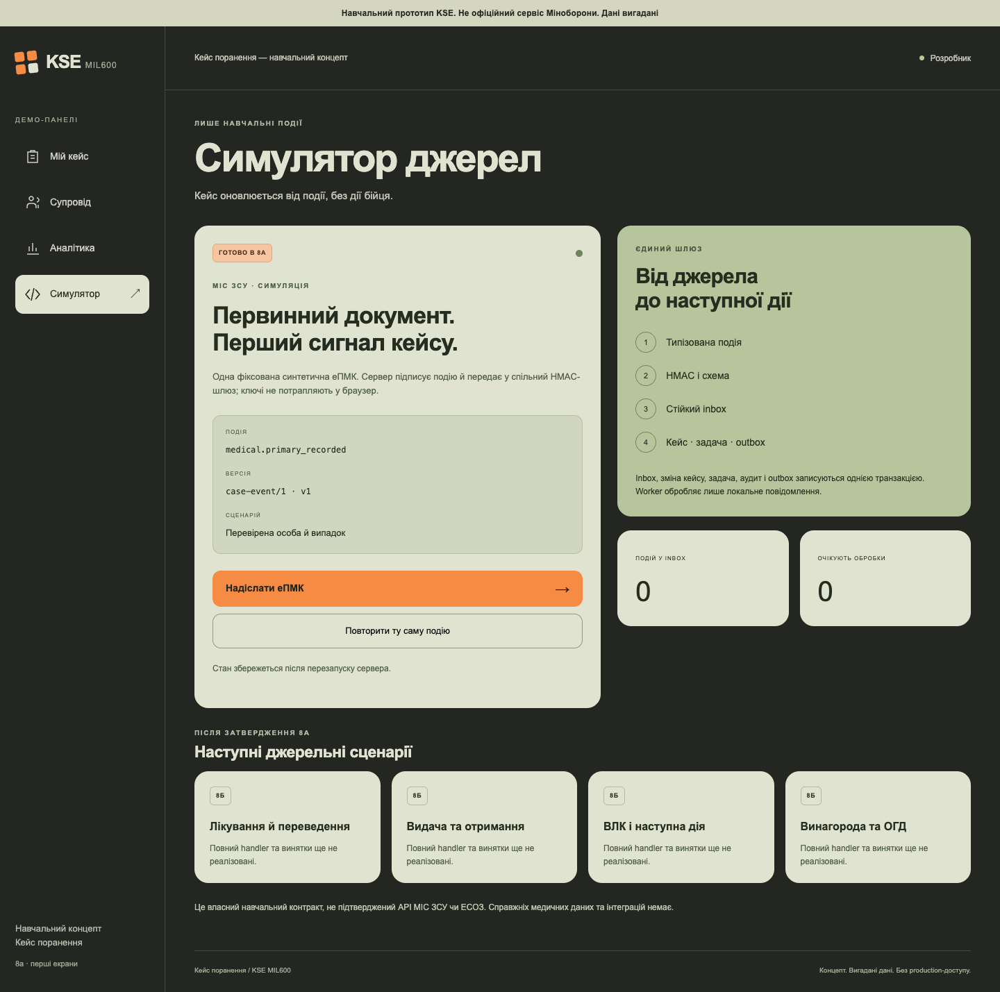

# Кейс поранення — навчальний прототип

**2026-11-13 · фаза 8а на затвердженні.** Є БД / seed, серверні доступи та перший екран кожної з чотирьох панелей. Це неповний прототип: повний D1 / AC01–AC10 — **8б після нового затвердження**. [Фактична готовність і лінія відсікання](../docs/prototype-8a.md) · [ADR 0008 / альтернативи](../docs/architecture/adr/0008-demo-stack-and-physical-schema.md) · [рев’ю](../docs/reviews/phase-8a.md).

На всіх екранах: **«Навчальний прототип KSE. Не офіційний сервіс Міноборони. Дані вигадані»**. Немає справжніх медичних даних, паролів, upload, логотипів / емблем / тризуба, геолокації чи реального зовнішнього обміну.

## Запуск

Потрібен **Node.js 26.8.2** (pin у `.node-version`, перевірений API `node:sqlite`) і npm. Відкрийте цю папку `prototype/` у терміналі. Перше встановлення й запуск однією командою:

```sh
npm ci --ignore-scripts && npm run dev
```

Наступні запуски: **`npm run dev`**. Відкрийте **http://127.0.0.1:4317**; саме IP, не `localhost`. Команда збирає TypeScript / React, застосовує [SQL-міграцію](db/migrations/001-initial.sql) й автоматично додає [seed](server/seed.ts). Окремий PostgreSQL, Docker або env-ключі вручну для локального показу не потрібні. `npm start` — запуск уже зібраного застосунку. Зупинка: Ctrl+C. Немає deployment; production / зовнішній Host / bind відхиляються.

CLI генерує окремі випадкові source / audit ключі в ігнорований `.runtime/local.env` (0600, папка 0700), далі читає їх як env через helper фази 7. Не копіюйте цей файл, `.runtime/*.sqlite*`, cookie чи логи в GitHub / чат. Якщо ключі вже задаються env, потрібні всі п’ять із `.env.example`, кожний окремий 32-byte hex. Частковий / слабкий / однаковий набір відхиляється; ключів у browser bundle немає.

Після зупинки сервера можна скинути **лише навчальний стан цього застосунку**:

```sh
npm run demo:reset
```

Команда перевіряє marker свого seed, очищає тільки `.runtime/demo.sqlite` та його WAL / SHM; секрети лишаються, наступний запуск відновить seed. Не запускайте reset паралельно із сервером. Невідома БД і нестандартний DEMO_DB_PATH не очищаються. Для тестів аналогічно ізольовано використовується лише `.runtime/e2e.sqlite`.

## Демо-ролі й дані

Оберіть панель у меню: це **демо-вибір ролі, не справжня автентифікація**. Будь-хто з локальним доступом до процесу може вибрати навчальну роль. Сервер мапує profile на свій roster, видає opaque HttpOnly / SameSite=Strict cookie на 15 хв і CSRF; при зміні ролі старий token недійсний. Роль / чинний grant / перевірене призначення / case scope перевіряються при кожному запиті. Query-параметр `role` / `unit` прав не надає. Після закінчення сесії оновіть сторінку й оберіть роль знову.

| Панель | Реальна поведінка 8а |
|---|---|
| Боєць | Свій вигаданий кейс 01, наступна дія / owner, timeline, технічний чекліст, орієнтир «дату отримання підтвердити», гайд, два окремі фінансові стани |
| Командир / супровід | Перемикач двох різних seed-ролей; лише 10 призначених кейсів групи А, без клінічного body / source refs / місця лікування; адміністративний запит — резерв, disabled до 8б |
| Аналітик | Шість визначень BO й обмеження; **немає числових результатів / total / персональних рядків / довільних фільтрів**. Baseline [TBD], guard із ядра ще має бути під’єднаний до розрахунків 8б |
| Dev | Фіксована синтетична еПМК через спільний gateway з HMAC / схемою / source policy; повтор не дублює ефект. Інші типи ще не застосовуються повними handlers |

У seed 30 вигаданих учасників / кейсів, три навчальні групи й дев’ять умовних закладів; різні стадії, невідомі дати, повернення та навчальні минулі дати. Це не baseline і не спостереження про реальних військових. Одержання військовослужбовцем, внесення еПМК, inbox та квитанція ВЛК — різні дати. Seed-строки вже задані fixture: runtime-юридичний календар ще не реалізовано. Командир не створює медичного факту; основний тригер — еПМК, адміністративна ініціація лише запасна.

## Короткий показ 8а

1. Перегляньте чотири перші екрани, на телефоні — нижнє меню. Кнопка «Що буде далі» відкриває гайд у межах сторінки.
2. У dev натисніть «Надіслати еПМК»: після durable commit — accepted, business_applied=true для мінімального primary handler. Поверніться в «Мій кейс»: з’явилася подія. Стадія лікування не відмотується назад.
3. Повторіть ту саму подію: duplicate, без нових кейсів / задач / outbox. Перезапуск сервера зберігає inbox і dedupe; старий nonce теж перевіряється в БД у своєму часовому вікні. Нова версія без доведеного порядку — на розбір, не тихе сортування.

Кнопка dev викликає **ту саму функцію gateway**, що й HTTP `POST /api/integration/events`, з тими самими байтами конверта / HMAC-перевірками / схемою / storage transaction. Це внутрішній виклик, не імітація справжнього webhook установи й не прямий UPDATE з UI. Протокол — [контролі фази 7](../docs/security/controls.md); для app HTTP дозволено тільки відсутній або точний same-origin Origin. Доступ до demo-simulator не дає source keys браузеру. У 8а готовий лише вузький primary handler; інші валідні типи можуть бути прийняті в inbox як pending_8b / pending_review з business_applied=false.

Старий security-harness фази 7 повертає тільки validated_only; це окремий тестовий adapter, не маршрут живого app. App `Ingress.authenticate` / schema / global source policy перевикористовують те саме ядро. БД пише inbox / CaseEvent / Task / audit / outbox атомарно. Worker підтверджує **тільки локальне** повідомлення проєкції; немає push, електронного направлення назовні чи медичного обміну. Журнали append-only на рівні звичайного SQL, але власник файлу не ізольований.

## Перевірки

```sh
npm test
npm run lint
npm run build
npm audit --audit-level=high
npx playwright install chromium
npm run test:e2e
```

`npm test`: **37** тестів ядра / HTTP / SQLite, у т.ч. рестарт dedupe / nonce, одночасні повтори, atomic rollback при збої audit, scope / відкликання / 403 клініці, CSRF / Origin / Host, недопуск чужої БД, перетини mapping й DB-інваріанти. `test:e2e`: **9** сценаріїв реального UI, чотири панелі / дві ширини, role switch, серверні 403 / 404, порожній числовий агрегат і спільний dev gateway. **Це ще не e2e повного маршруту до ВЛК.** CI додає CodeQL / gitleaks і браузерні перевірки на Ubuntu.

Для локального Chrome можна задати `PLAYWRIGHT_CHROMIUM_EXECUTABLE_PATH` до його виконуваного файлу. Оновити скриншоти з чистого e2e seed: `UPDATE_SCREENSHOTS=true npm run test:e2e`. Числові результати BO й доповнювальне пригнічення на реальній для демо когорті перевірятимуться у 8б; зараз значень не повертаємо. Повний ASVS L2 / SSO / TLS / шифрування / відновлення backup / production не виконані.

## Скриншоти для затвердження

Справжні captures локального app, **2026-11-13**, 1440×1050 desktop (повна сторінка) і 390×844 mobile (перший viewport). Стан seed до надсилання події; не намальовані mockups. Публічна візуальна звірка й джерела — [ADR 0008](../docs/architecture/adr/0008-demo-stack-and-physical-schema.md).

| Панель | Комп’ютер | Телефон |
|---|---|---|
| Боєць | [повний екран](screenshots/patient-desktop.png) | [перший екран](screenshots/patient-mobile.png) |
| Супровід | [повний екран](screenshots/staff-desktop.png) | [перший екран](screenshots/staff-mobile.png) |
| Аналітик | [повний екран](screenshots/analytics-desktop.png) | [перший екран](screenshots/analytics-mobile.png) |
| Dev | [повний екран](screenshots/simulator-desktop.png) | [перший екран](screenshots/simulator-mobile.png) |






Після 8а — **СТОП**. [D1 / P0–P4 / лінія відсікання](../docs/architecture/demo-plan.md) збережені; 8б виконує решту handler / дій / фінансових доказів / BO / винятків, потім окреме затвердження перед рештою фази 9. Публічного deployment немає.
